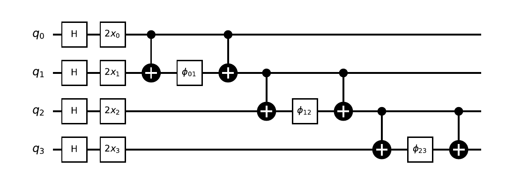
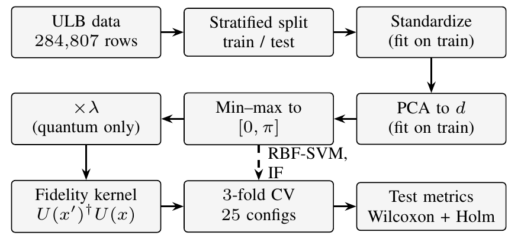
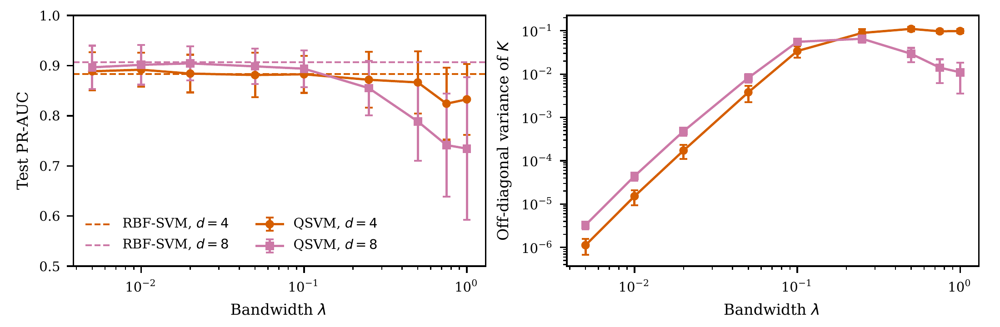
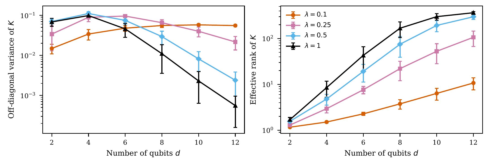
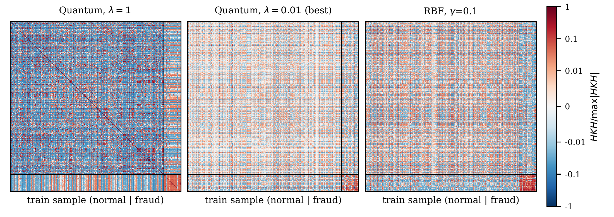
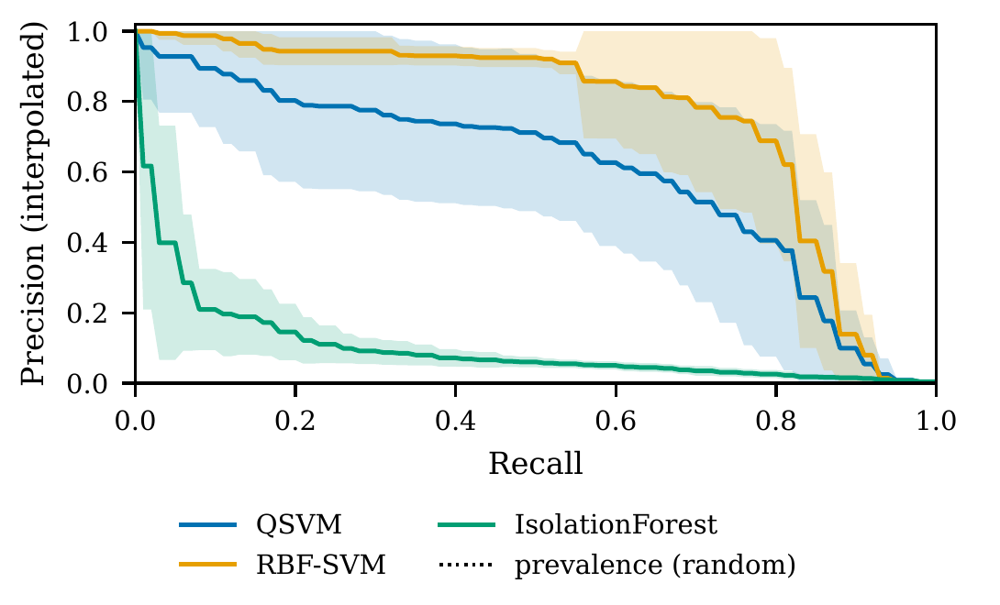
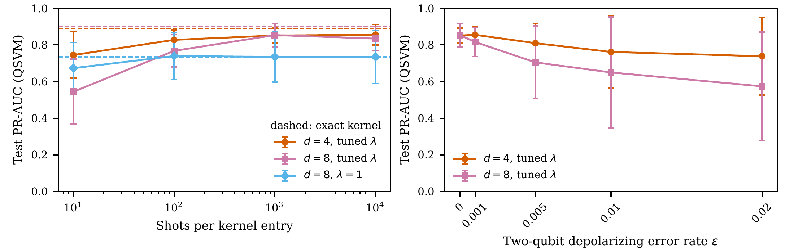

# Quantum Kernels for Credit-Card Fraud Detection

**A fair benchmark of bandwidth, concentration and noise**

This project compares a **quantum kernel support vector machine (QSVM)** with two classical baselines, an **RBF-kernel SVM** and an **Isolation Forest**, on the ULB credit-card fraud data set. All three models get the same tuning budget, the same cross-validation folds and the same features, and the comparison uses paired statistical tests over 10 random splits.

**Bottom line:** we find **no evidence of a quantum advantage**. The QSVM matches a well-tuned RBF-SVM only when its kernel bandwidth is small. In that regime the quantum kernel behaves like a classical RBF kernel, and it is also the regime most sensitive to measurement noise.

> Course project for **Quantum Computing (25AM3504)**, Dept. of CSE (AI & ML), Dayananda Sagar University.

---

## Contents

- [Key findings](#key-findings)
- [Background: how a quantum kernel SVM works](#background-how-a-quantum-kernel-svm-works)
- [Method](#method)
- [Results](#results)
- [Limitations and next steps](#limitations-and-next-steps)
- [Repository contents](#repository-contents)
- [Reproducing the study](#reproducing-the-study)
- [References](#references)

---

## Key findings

| | Finding |
|---|---|
| 🟰 **Tie at 10% fraud** | QSVM and RBF-SVM are statistically indistinguishable at 4 and 8 qubits (PR-AUC 0.891 vs 0.883 and 0.900 vs 0.907, Holm-adjusted *p* = 0.387). Both clearly beat the Isolation Forest (*p*<sub>Holm</sub> = 0.008). |
| 🎚️ **Bandwidth decides** | With bandwidth λ ≤ 0.1 the QSVM matches the RBF-SVM. Without it (λ = 1) the kernel **concentrates** exponentially with qubit count and accuracy drops (0.734 at *d* = 8). |
| 🔁 **It acts like an RBF kernel** | The tuned quantum kernel correlates with the tuned RBF kernel at *r* = 0.86–0.92. Its geometric difference (6–11) is well below the √n ≈ 20 needed for any advantage. An entanglement-free, classically simulable Z map performs just as well. |
| 📉 **The real fraud rate changes the picture** | At 0.2% fraud and 8 qubits, the RBF-SVM reaches PR-AUC 0.742 against 0.584 for the QSVM, but the ROC-AUCs are almost identical (0.961 vs 0.951). At 80% recall that means about 2.0 vs 6.9 false alarms per 1,000 transactions. |
| 🔊 **Fragile to noise** | The bandwidth-tuned kernel is the most sensitive to shot noise: at *d* = 8, PR-AUC falls from 0.900 (exact) to 0.545 with 10 shots. |
| 💸 **Expensive on hardware** | Estimating a single train and test kernel pair would take about **2.4 × 10⁸ shots** (239,800 circuits × 1,000 shots). |

---

## Background: how a quantum kernel SVM works

1. **Encode:** each (scaled) feature vector *x* is loaded into a quantum state by a feature-map circuit, |φ(x)⟩ = U(x)|0⟩<sup>⊗d</sup>, using one qubit per feature.
2. **Overlap:** the similarity of two points is the **fidelity kernel**

   k(x, x′) = |⟨0| U(x′)† U(x) |0⟩|²

   On hardware this is estimated with the *compute–uncompute* circuit U(x′)†U(x), where k is the probability of measuring the all-zeros string.
3. **Classify:** the resulting Gram matrix goes into a standard soft-margin SVM. Only the kernel is quantum; the SVM solver is the usual classical one.

**Feature maps.** The main feature map is the **ZZ map** (Havlíček et al.): Hadamards, phase gates P(2xⱼ), and CX–P–CX entangling blocks between neighbouring qubits, repeated *r* = 2 times. The **Z map** keeps only the single-qubit layers. Its kernel factorises and can be computed classically in O(d), so it serves as an entanglement-free control.

<p align="center"></p>

**Two effects matter:**

- **Kernel concentration:** for expressive feature maps, off-diagonal kernel values approach a constant exponentially fast in the number of qubits. The Gram matrix tends to the identity, the SVM memorises the training set, and resolving the remaining differences takes exponentially many shots.
- **Bandwidth:** scaling the inputs, x → λx with λ < 1, counteracts concentration. For small λ the kernel expands as k ≈ 1 − λ²q(x, x′), which is RBF-like. A smaller λ can be compensated by a larger SVM constant, so the optimum lies on a ridge C ∝ λ⁻².

---

## Method

### Data

The [ULB credit-card fraud data set](https://www.kaggle.com/datasets/mlg-ulb/creditcardfraud) contains 284,807 European card transactions, of which 492 (0.173%) are fraudulent. Each transaction has 30 numeric features: time, amount and 28 anonymised PCA components. The data is used as published and is never resampled synthetically.

### Pipeline (per seed, 10 seeds)

<p align="center"></p>

1. **Stratified split:** disjoint train and test sets of 400 transactions each, with 10% fraud (40 frauds per set). This is small enough to simulate every kernel exactly.
2. **Standardise** all 30 features (fitted on the training split only).
3. **PCA to *d* components**, where *d* is the number of qubits. This keeps 50.1% of the variance at *d* = 4 and 66.3% at *d* = 8.
4. **Min–max scale** each component to [0, π]; test values are clipped.
5. **Multiply by the bandwidth λ** (quantum kernel only).
6. **Compute the fidelity kernel** by exact statevector simulation in Qiskit. Every Gram matrix is checked to be symmetric, have a unit diagonal, have entries in [0, 1] and be positive semi-definite.
7. **Tune** with 3-fold stratified CV scored by PR-AUC, then refit on the full training split and evaluate once on the test split.

The classical models receive the same scaled PCA features (without λ). As a reference they are also trained on all 30 standardised features ("Std-30").

### Models and equal-budget tuning

Every model gets a fixed grid of **25 configurations**, scored on the same CV folds:

| Model | Parameter | Values |
|---|---|---|
| QSVM | C | 0.1, 1, 10, 100, 1000 |
| QSVM | bandwidth λ | 0.01, 0.02, 0.05, 0.1, 0.25 |
| RBF-SVM | C | 0.1, 1, 10, 100, 1000 |
| RBF-SVM | γ | 10⁻⁴, 10⁻³, 0.01, 0.1, 1 |
| Isolation Forest | trees | 50, 100, 200, 300, 500 |
| Isolation Forest | max. samples | 0.05, 0.1, 0.25, 0.5, auto |

Both SVMs use class-balanced weights. A **grid-edge diagnostic** flags whether a chosen value on the edge of its grid is still improving, which would mean the grid cut it off, or has reached a plateau.

### Metrics

- **Primary:** PR-AUC (average precision). It is sensitive to false positives among many negatives, unlike ROC-AUC.
- **Also reported:** ROC-AUC, recall at 1% and 5% FPR, precision@k, best F1 and MCC.
- **At realistic prevalence:** precision and false positives per 1,000 transactions at 50% and 80% recall.

### Statistics

- Every model sees the same 10 splits, so comparisons are **paired by seed**.
- **Two-sided Wilcoxon signed-rank tests** on per-seed PR-AUC, with **Holm correction** within each experiment.
- Effect sizes are mean paired differences with **95% bootstrap CIs** (10,000 resamples).

### Kernel diagnostics

- Mean and variance of the off-diagonal entries (concentration)
- Centred kernel–target alignment (KTA)
- Effective rank
- Geometric difference g(K<sub>RBF</sub> ‖ K<sub>Q</sub>)
- Pearson correlation with the tuned RBF kernel

### Noise models

Noise is applied analytically to the exact kernels:

- **Finite shots:** each entry is replaced by Bin(S, K)/S, with S ∈ {10, 100, 1,000, 10,000}.
- **Global depolarizing noise:** K → pK + (1 − p)2⁻ᵈ with p = (1 − ε)<sup>n₂q</sup>, where n₂q is the number of two-qubit gates in the transpiled circuit and ε ∈ {0, 0.001, 0.005, 0.01, 0.02}. This is followed by 1,000-shot sampling.

C is re-tuned on every noisy kernel. Noisy kernels that are not positive semi-definite have their negative eigenvalues clipped to zero.

### Implementation

- Python with **Qiskit** (statevector simulation) and **scikit-learn**, running on a CPU (Apple M1).
- One configuration file holds every setting and seed, and kernels are cached on disk, keyed by the rows and parameters.
- An exact kernel entry costs about 9 µs at *d* = 8, and all experiments take **77 minutes** in total.

---

## Results

All numbers are means ± standard deviations over 10 seeds.

### Main comparison at 10% fraud

| Features | Model | PR-AUC | ROC-AUC | Recall@1%FPR |
|---|---|---|---|---|
| PCA-4 | QSVM | **0.891 ± 0.036** | **0.941 ± 0.020** | **0.820 ± 0.071** |
| PCA-4 | RBF-SVM | 0.883 ± 0.047 | 0.939 ± 0.024 | 0.812 ± 0.071 |
| PCA-4 | Isolation Forest | 0.767 ± 0.087 | 0.916 ± 0.032 | 0.542 ± 0.164 |
| PCA-8 | QSVM | 0.900 ± 0.031 | 0.944 ± 0.026 | 0.838 ± 0.059 |
| PCA-8 | RBF-SVM | **0.907 ± 0.031** | **0.949 ± 0.022** | **0.843 ± 0.058** |
| PCA-8 | Isolation Forest | 0.704 ± 0.081 | 0.921 ± 0.039 | 0.375 ± 0.132 |
| Std-30 | RBF-SVM | **0.934 ± 0.020** | **0.972 ± 0.018** | **0.840 ± 0.064** |
| Std-30 | Isolation Forest | 0.832 ± 0.061 | 0.938 ± 0.031 | 0.670 ± 0.115 |

| Comparison | *d* | ΔPR-AUC [95% CI] | *p*<sub>Holm</sub> |
|---|---|---|---|
| QSVM − RBF-SVM | 4 | +0.008 [−0.001, +0.019] | 0.387 |
| QSVM − RBF-SVM | 8 | −0.007 [−0.016, +0.001] | 0.387 |
| QSVM − Isolation Forest | 4 | +0.124 [+0.083, +0.167] | **0.008** |
| QSVM − Isolation Forest | 8 | +0.196 [+0.152, +0.242] | **0.008** |

Across *d* ∈ {2, 4, 6, 8} qubits and training sizes from 100 to 800, no QSVM–RBF difference is significant. The Isolation Forest degrades steadily as *d* grows, from 0.840 to 0.704.

### Bandwidth and concentration

<p align="center"></p>

- For λ ≤ 0.1, QSVM PR-AUC is flat at the RBF-SVM level: 0.881–0.892 at *d* = 4 and 0.894–0.904 at *d* = 8.
- At λ = 1 it drops to 0.833 (*d* = 4) and 0.734 (*d* = 8).
- Without bandwidth, the off-diagonal variance falls by a factor of 123 from *d* = 2 to *d* = 12. The effective rank rises to 365.8 of a possible 400, so the Gram matrix approaches the identity.
- At λ = 0.1 there is no concentration up to 12 qubits.

<p align="center"></p>

### The quantum kernel behaves like an RBF kernel

<p align="center"></p>

- For λ ≤ 0.1, the quantum kernel's off-diagonal entries correlate with the tuned RBF kernel at *r* = 0.86–0.92.
- The geometric difference is 6.3–10.7, far below √n ≈ 20.
- The RBF kernel is better aligned with the labels than every quantum kernel (KTA 0.484 vs ≤ 0.410 at *d* = 4).
- The **entanglement-free Z map** performs as well as the ZZ map in all 6 paired comparisons (*p*<sub>Holm</sub> = 1.000).

### Realistic prevalence (0.2% fraud)

The test sets have 40 frauds among 20,000 normal transactions; training is the same as in the main experiment.

| *d* | Model | PR-AUC | ROC-AUC | FP / 1k @ 80% recall |
|---|---|---|---|---|
| 8 | QSVM | 0.584 ± 0.185 | 0.951 ± 0.022 | 6.90 ± 8.02 |
| 8 | RBF-SVM | **0.742 ± 0.066** | **0.961 ± 0.013** | **2.04 ± 3.96** |
| 8 | Isolation Forest | 0.092 ± 0.036 | 0.936 ± 0.024 | 72.80 ± 37.45 |

- ROC-AUC barely moves, while PR-AUC and false-alarm counts show the real differences.
- The QSVM is about 2.8× less stable across seeds.
- Its gap to the RBF-SVM (−0.158) is not significant with 10 seeds (*p*<sub>Holm</sub> = 0.098).

<p align="center"></p>

### Noise and hardware cost

<p align="center"></p>

- **Shot noise.** At *d* = 8, the tuned kernel goes from 0.900 (exact) to 0.545 with 10 shots, 0.768 with 100 shots and 0.854 with 1,000 shots. Its values are nearly constant, so the useful signal (variance ≈ 4.4 × 10⁻⁵) is smaller than the shot noise. The unscaled kernel (λ = 1) barely changes, but it starts lower.
- **Depolarizing noise.** At ε = 0.02, PR-AUC falls to 0.574 ± 0.296 at *d* = 8 and 0.738 ± 0.212 at *d* = 4. Sampled noisy kernels are almost never positive semi-definite: 209 of 250 needed clipping.
- **Hardware cost.**
  - One kernel pair needs 239,800 circuits, which at 1,000 shots per circuit is about **2.4 × 10⁸ shots**.
  - At *d* = 8, each kernel circuit has depth 68 and 54 two-qubit gates on a linear coupling map.
  - The 100 kernels of the main experiment alone would need 2.4 × 10⁷ circuits and 2.4 × 10¹⁰ shots.

---

## Limitations and next steps

- **Statistical power is limited.** With 10 paired seeds the smallest attainable Wilcoxon *p*-value is 0.002, so the prevalence gap at *d* = 8 remains inconclusive.
- **The training sets are small** (400 transactions), so that every kernel can be simulated exactly.
- **The input is compressed** to at most 8 PCA components, which itself costs accuracy.
- **The scope is narrow:** one data set and one entangling feature-map family.
- **Noise is modelled analytically** rather than simulated at device level or run on hardware.
- **The Isolation Forest grid** was sometimes still improving at its edge.

**Next steps:**

- More seeds and larger training sets
- Structured (non-PCA) encodings
- Device-level noise models and real hardware runs

---

## Repository contents

```
.
├── README.md
└── docs/
    ├── Quantum_Kernels_Fraud_Detection.pptx   # 12-slide presentation (two speakers, with speaker notes)
    └── figures/                               # figures from the project report used above
```

**Presentation.** The deck is split evenly between two speakers. The title slide and the conclusion are shared.

| Slides | Speaker | Topic |
|---|---|---|
| 1 | Both | Title |
| 2–6 | Speaker 1 | Problem, how a QSVM works, concentration vs bandwidth, pipeline, fair benchmark design |
| 7–11 | Speaker 2 | Main result, bandwidth, RBF-like behaviour, realistic prevalence, noise and hardware cost |
| 12 | Both | Conclusion, limitations, Q&A |

> **Code status:** the experiment code, configuration and result files are not in this repository yet.

---

## Reproducing the study

The study needs:

- **Python 3** with **Qiskit** (for statevector simulation and transpilation) and **scikit-learn** (for the SVMs, Isolation Forest, PCA and metrics)
- **NumPy** and **SciPy** (for the statistics)
- **Matplotlib** (for the figures)
- The **ULB credit-card fraud data set** (`creditcard.csv`) from [Kaggle](https://www.kaggle.com/datasets/mlg-ulb/creditcardfraud)

The settings to reproduce are described under [Method](#method): the seeds, sample sizes, grids, folds and noise levels.

---

## References

1. V. Havlíček et al., "Supervised learning with quantum-enhanced feature spaces," *Nature* 567, 2019.
2. M. Schuld and N. Killoran, "Quantum machine learning in feature Hilbert spaces," *Phys. Rev. Lett.* 122, 2019.
3. H.-Y. Huang et al., "Power of data in quantum machine learning," *Nat. Commun.* 12, 2021.
4. S. Thanasilp, S. Wang, M. Cerezo and Z. Holmes, "Exponential concentration in quantum kernel methods," *Nat. Commun.* 15, 2024.
5. R. Shaydulin and S. M. Wild, "Importance of kernel bandwidth in quantum machine learning," *Phys. Rev. A* 106, 2022.
6. A. Canatar et al., "Bandwidth enables generalization in quantum kernel models," *TMLR*, 2023.
7. J. Bowles, S. Ahmed and M. Schuld, "Better than classical? The subtle art of benchmarking quantum machine learning models," arXiv:2403.07059, 2024.
8. A. Dal Pozzolo et al., "Calibrating probability with undersampling for unbalanced classification," *IEEE SSCI*, 2015.
9. F. T. Liu, K. M. Ting and Z.-H. Zhou, "Isolation forest," *IEEE ICDM*, 2008.
10. T. Saito and M. Rehmsmeier, "The precision-recall plot is more informative than the ROC plot when evaluating binary classifiers on imbalanced datasets," *PLoS ONE* 10(3), 2015.
